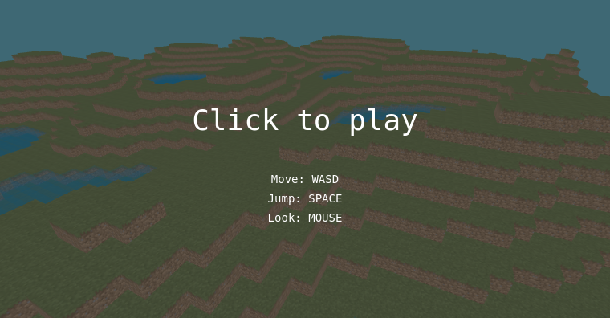
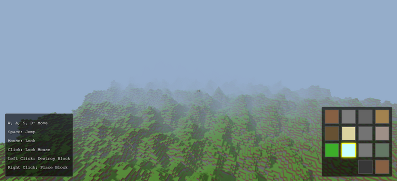
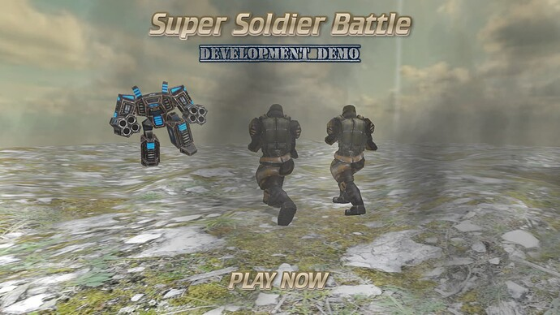
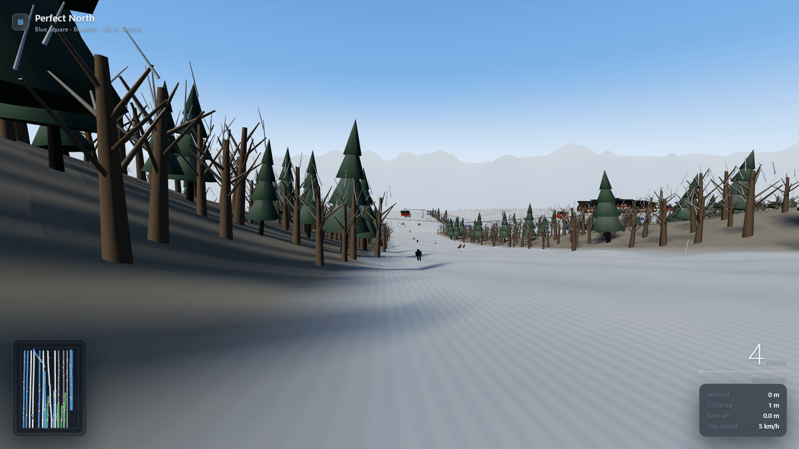
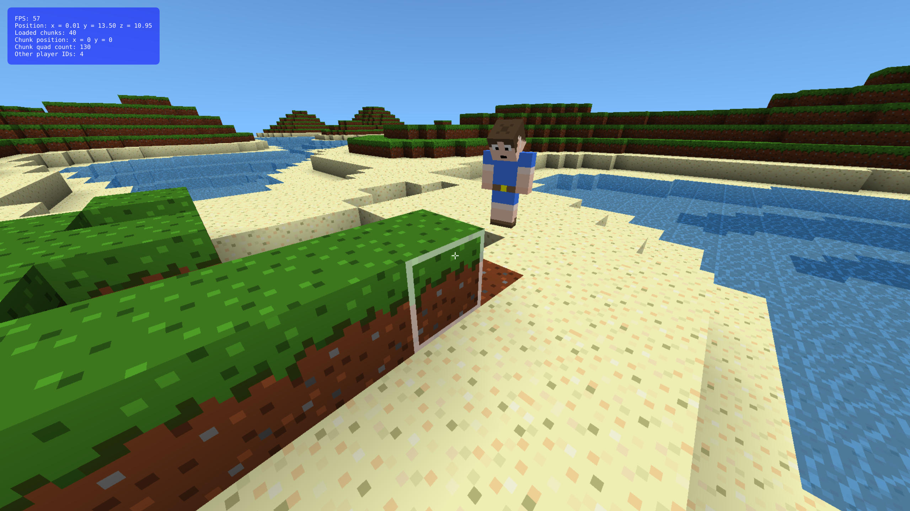
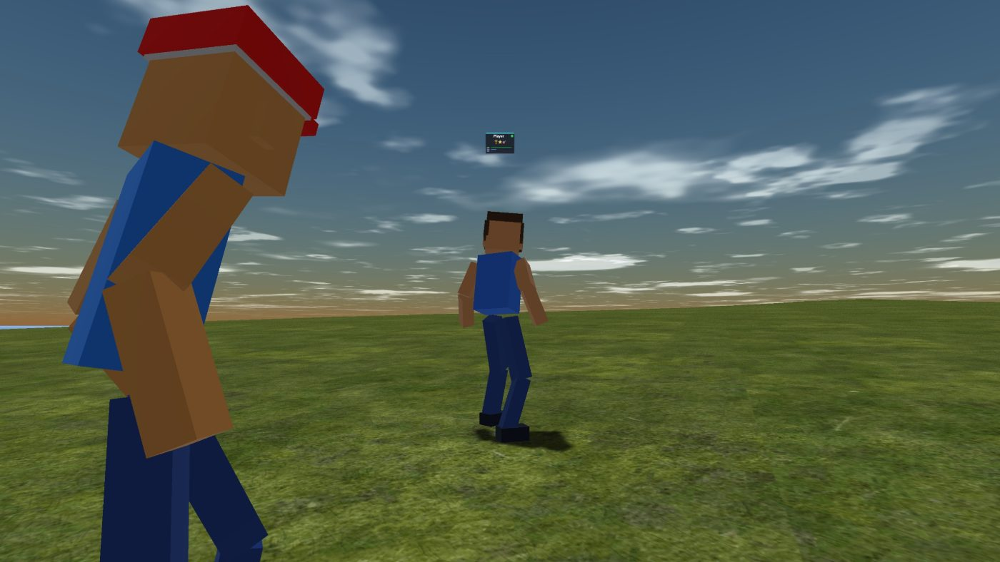

# JS First-Person Open-World Games — Reference List

Browser games/engines built in JavaScript (mostly Three.js) with a first-person
camera and an open/explorable world. Collected Oct 2026 via web search; not
exhaustive. Screenshots in `screenshots/` are taken from each project's own
README, itch.io page, or forum post.

## Games

### Overrun — open-world alien FPS
Three.js, no build step, no assets — everything procedural. 3.2 km map with
towns (Haven, Ridgeport), quests, 9 alien types, 8 weapons, drivable cars.
Run locally with `python3 serve.py`.
[GitHub (jod1248/openworld)](https://github.com/jod1248/openworld)

*No screenshot published — run it locally to see it.*

### AioCraft
Three.js voxel world generated from Perlin noise, rendered with GPU instancing.
[GitHub](https://github.com/valentecaio/aiocraft) · [Play on itch.io](https://valentecaio.itch.io/aiocraft)

### Voxel World HTML
Minimal Minecraft-style voxel engine (Three.js + Simplex Noise); place/destroy blocks.
[Play on itch.io](https://sleepyprogrammer1012.itch.io/voxel-world-html) (GitHub repo is gone)

### Open World Super Soldier Battle
Three.js + AWS serverless open-world shooter demo. Screenshot is the title
screen, showing a third-person view.
[three.js forum post](https://discourse.threejs.org/t/open-world-super-soldier-battle-game-demo/35988) · [Play](https://www.shanebrumback.com/super-soldier-battle-intro.html)

### First-Person Game Engine + Level Demo (ameobea)
Three.js FPS engine (ammo.js physics, god rays, N8AO) with a playable level.
[three.js forum post](https://discourse.threejs.org/t/first-person-game-engine-overview-level-demo/55685) · [Source](https://github.com/ameobea/sketches-3d) · [Play a level](https://3d.ameo.design/smoke.html)

### fall-line
First-person skiing in the browser: 32 procedural mountains, synthesised
soundtrack, no finish line. Three.js, no build step.
[GitHub](https://github.com/WiseeCarrot/fall-line) · [Play](https://wiseecarrot.github.io/fall-line/)

### voxel-game-js
Minecraft clone in plain JavaScript + WebGL, no libraries; Deno multiplayer
server. Screenshot shows another player in the world.
[GitHub](https://github.com/guckstift/voxel-game-js)

### webgpu-world
Native WebGPU world (no engine): procedural island, day/night, weather, ocean,
voxel avatars, peer-to-peer multiplayer over WebRTC. Screenshot shows other
players' avatars.
[GitHub](https://github.com/estebanrfp/webgpu-world) · [Play](https://estebanrfp.github.io/webgpu-world/)

## Not confirmed first-person

### threejs-open-world
Open-world adventure with procedural terrain, physics, character movement and
camera controls. The character movement suggests third-person.
[GitHub](https://github.com/JiguDev/threejs-open-world)

*No screenshot published (the repo only has a Vite template logo).*

## Engines / libraries for building one

| Name | Notes | Link |
|------|-------|------|
| voxel-engine | Voxel engine on Three.js (npm) | [npm](https://npmjs.com/voxel-engine) |
| 3D open-world engine on Three.js | Engine for world creation | [three.js forum](https://discourse.threejs.org/t/3d-open-world-game-engine-based-on-three-js/45369) |
| Three.js 3D browser game engine | Modular engine for large open-world environments | [three.js forum](https://discourse.threejs.org/t/three-js-3d-browser-game-engine/87760) |
| ProceduralTerrains | Infinite/planet terrain generator, Three.js | [GitHub](https://github.com/ZyFou/ProceduralTerrains) |

## Browse more

- [GitHub topic: open-world-game (JavaScript)](https://github.com/topics/open-world-game?l=javascript)
- [GitHub topic: first-person-game](https://github.com/topics/first-person-game)
- [Three.js Games collection](https://threejsresources.com/games)
- [awesome-babylonjs](https://github.com/Symbitic/awesome-babylonjs)
